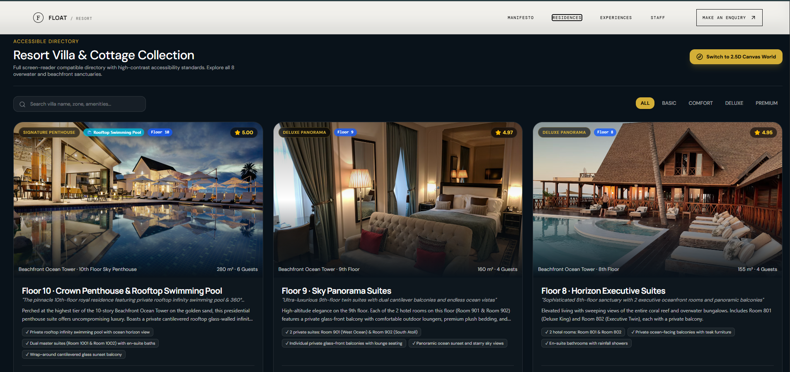

<p align="center">
  
</p>

<h1 align="center">FLOAT — A Quiet Architecture for Living</h1>
<h3 align="center">Private villas, considered experiences, and a slower way to discover the coast</h3>

<p align="center">
  
  
  
  
  
</p>

---

## Executive Summary

> "The space we inhabit is a reflection of the pauses we take between our thoughts." — *Float*

**Float** is a resort experience showcasing private villas, curated stays, and guest services through an editorial landing page, interactive resort map, residence directory, and staff operations dashboard.

---

##  App Tour (Screenshots)

### 1. Resort Landing Page

<p align="center">
  
</p>
*Float Resort homepage — coastal hero, navigation and enquiry entry point.*

### 2. The Resort Philosophy

<p align="center">
  
</p>
*The resort philosophy — a visual introduction to its design and sense of place.*

### 3. Residence Collection

<p align="center">
  
</p>
*Residence collection — featured villas and curated places to stay.*

### 4. Guest Experiences

<p align="center">
  
</p>
*Guest experiences — resort services and activities.*

### 5. Interactive 2D Resort Map

<p align="center">
  
</p>
*Interactive map — explore resort locations and villa categories.*

### 6. Residence Directory

<p align="center">
  
</p>
*Residence directory — browse and filter available villas.*

### 7. Staff Operations Dashboard

<p align="center">
  
</p>
*Staff operations — manage reservations, guest profiles and villa status.*

##  Key Features

- **Curated Digital Exhibition**: A beautiful, fluid grid displaying handcrafted art pieces categorised into Vessels, Lighting, Textiles, and Objects.
- **Bespoke Commissions Interface**: A fully interactive commission tool that allows clients to specify materials, finishes, dimensions, and upload reference files under custom budgets.
- **Master Studio Portal**: Live inline catalog curation. Access the admin view via the **Unlock Studio** link to edit, archive, or list new artisanal creations dynamically (Passcode: `float`).
- **Seamless Cart & Checkout**: A premium flyout cart drawer and structured checkout flow built for an immersive retail experience.
- **Rich Micro-animations**: Powered by Motion to bring the aesthetic elements to life with organic, smooth transitions.

---

## 🛠 Technology Stack

- **Framework**: [React 19](https://react.dev/) + [TypeScript](https://www.typescriptlang.org/)
- **Build Tool**: [Vite 6](https://vite.dev/) (Pre-configured for lightning-fast HMR)
- **Styling**: [Tailwind CSS v4](https://tailwindcss.com/) via `@tailwindcss/vite`
- **Animations**: [Motion](https://motion.dev/)
- **Icons**: [Lucide React](https://lucide.dev/)
- **Routing**: [React Router v7](https://reactrouter.com/)

---

##  Getting Started

### Prerequisites
Make sure you have [Node.js](https://nodejs.org/) installed on your machine.

### Installation

1. **Clone the repository and install dependencies**:
   ```bash
   npm install
   ```

2. **Configure environment variables (Optional)**:
   Create a `.env.local` file based on `.env.example`:
   ```bash
   cp .env.example .env.local
   ```

3. **Start the local development server**:
   ```bash
   npm run dev
   ```
   The application will be running at [http://localhost:3000/](http://localhost:3000/).

---

##  Available Scripts

- `npm run dev`: Starts the local development server on port 3000.
- `npm run build`: Generates the optimized production build of the website in the `dist/` directory.
- `npm run preview`: Previews the production build locally.
- `npm run clean`: Cleans up local build outputs.
- `npm run lint`: Runs Typechecking over the TypeScript codebase.

---

##  Master Studio Portal Access

To test the curation features:
1. Scroll down to the website footer or menu and click **Unlock Studio**.
2. Enter the studio passcode: **`float`**
3. Once authenticated, you will unlock immediate **curator actions**:
   - Inline creation of new objects
   - Curatorial narration & price updates
   - Gallery image url updates
   - Archiving/deleting objects directly from the collection grid
